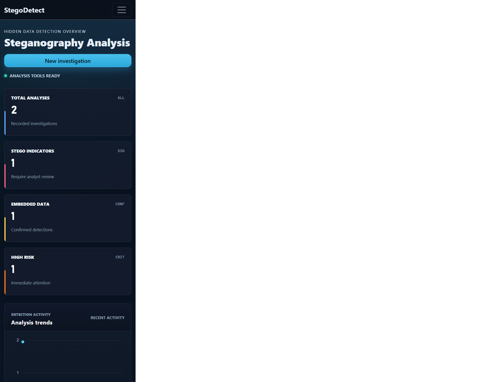

# StegoDetect

StegoDetect is a Flask-based forensic triage and steganography analysis application designed for cybersecurity investigations, evidence review, and SOC workflows. It combines upload validation, metadata analysis, file-signature review, steganography tooling checks, risk scoring, and investigation reporting into a single analyst-focused dashboard.

## Dashboard Preview



## Problem Statement

Organizations need to examine suspicious files for hidden payloads, metadata anomalies, and embedded content without executing unknown files. Traditional antivirus workflows often miss hidden data, mismatched file signatures, and embedded archive patterns. StegoDetect helps analysts quickly triage suspicious files and document findings in a structured, reviewable workflow.

## Features

- Secure file upload validation and duplicate detection
- SHA-256 hashing and signature-based file identification
- Metadata extraction and anomaly review
- String detection for URLs, commands, suspicious paths, and embedded payload indicators
- Base64, entropy, and hex analysis
- Optional external forensic tool checks for Steghide, Zsteg, Binwalk, and PNGcheck
- SOC-style risk scoring and severity classification
- Investigation history and analyst notes
- Exportable JSON, HTML, and PDF reports
- Professional dashboard with charts and live investigation summary cards

## Architecture Diagram

```text
+-------------------+      +----------------------+
| User / Analyst    | ---> | Flask Web App       |
| Browser           |      | app.py               |
+-------------------+      +----------------------+
                                  |
                                  v
                    +-------------------------------+
                    | Validation & File Handling    |
                    | file_analyzer.py              |
                    +-------------------------------+
                                  |
          +-----------------------+------------------------+
          |                                               |
          v                                               v
+---------------------------+                +---------------------------+
| Metadata / Strings / Hex  |                | Steganography Tools       |
| Entropy / Base64          |                | steghide / zsteg /        |
| Signature Review          |                | binwalk / pngcheck        |
+---------------------------+                +---------------------------+
          |                                               |
          +-----------------------+------------------------+
                                  v
                    +-------------------------------+
                    | Risk Engine + DB             |
                    | risk_engine.py + db.py       |
                    +-------------------------------+
                                  |
                                  v
                    +-------------------------------+
                    | Investigation Reports        |
                    | JSON / HTML / PDF            |
                    +-------------------------------+
```

## Technology Stack

- Python 3.11+
- Flask
- SQLite
- Jinja2 templates
- Pillow
- Pytest
- ExifTool (optional, recommended)
- External forensic utilities: Steghide, Zsteg, Binwalk, PNGcheck

## Project Structure

- `app.py` — Flask entry point and main routes
- `config.py` — upload, size, and path configuration
- `database/db.py` — SQLite investigation storage and search logic
- `modules/` — forensic analysis modules and tool integrations
- `templates/` — dashboard, analysis, and history UI
- `static/` — frontend styling and JS
- `tests/` — automated regression and workflow validation
- `docs/architecture.md` — architecture overview
- `scripts/generate_safe_samples.py` — safe sample creation helper

## Installation

### 1. Clone the repository

```bash
git clone https://github.com/your-org/stegodetect.git
cd stegodetect
```

### 2. Create a virtual environment

```bash
python -m venv .venv
```

Windows:

```powershell
.\.venv\Scripts\Activate.ps1
```

Linux/macOS:

```bash
source .venv/bin/activate
```

### 3. Install dependencies

```bash
python -m pip install --upgrade pip
python -m pip install -r requirements.txt
```

### 4. Install forensic utilities

StegoDetect gracefully handles unavailable tools, but the following utilities are recommended for full investigations.

#### Kali Linux

```bash
sudo apt update
sudo apt install -y steghide binwalk pngcheck libimage-exiftool-perl
sudo gem install zsteg
```

#### Ubuntu / Debian

```bash
sudo apt update
sudo apt install -y steghide binwalk pngcheck libimage-exiftool-perl
sudo gem install zsteg
```

#### Windows

- Install ExifTool and make sure `exiftool.exe` is on `PATH`
- Install Steghide via package manager or official source if available
- Install Zsteg with RubyGems: `gem install zsteg`
- Install Binwalk using pip or package manager
- Install PNGcheck from the official tools distribution

### 5. Run the app

```bash
python app.py
```

Open:

```text
http://127.0.0.1:5000/
```

## Usage Instructions

1. Open the dashboard.
2. Upload a suspicious image, archive, document, or binary.
3. Review the metadata and file-signature assessment.
4. Inspect the string, entropy, and base64 sections.
5. Check tool availability and any tool-generated findings.
6. Review the risk engine and analyst actions.
7. Export HTML, JSON, or PDF reports when ready.

## Screenshots

Additional screenshots can be added for:

- Investigation detail page
- History and filtering views
- Exported forensic report

## Example Investigation

A sample investigation workflow may look like this:

- A file is uploaded and validated.
- Metadata reveals GPS or embedded tags.
- String analysis finds suspicious URLs or PowerShell payloads.
- Base64 review detects encoded content candidates.
- Entropy analysis indicates suspicious data density.
- Risk engine marks the file as high severity and recommends further review.
- A JSON or PDF report is exported for case tracking.

## Sample Detection Results

Example output structure:

```json
{
  "risk_level": "critical",
  "risk_score": 82,
  "executive_summary": "Embedded payload and suspicious metadata were identified.",
  "findings": [
    {"title": "Embedded archive", "severity": "high"},
    {"title": "Suspicious strings", "severity": "medium"}
  ]
}
```

## Safe Sample Files

Safe sample files can be generated with:

```bash
python scripts/generate_safe_samples.py
```

These files are designed for UI validation and test automation without exposing sensitive or malicious content.

## Testing

Run the full suite:

```bash
python -m pytest -q
```

The automated tests cover upload validation, duplicate detection, file-type handling, metadata flows, risk scoring, report generation, and history/search behavior.

## Security Notes

- Uploaded files are never executed.
- File names are sanitized before saving.
- Duplicate detection uses SHA-256 hashes.
- External tools run with argument lists and timeouts.
- Report filenames are sanitized to reduce path traversal risk.
- Temporary files are cleaned up when possible.

## Limitations

- This project is a forensic triage and analyst workflow tool, not a replacement for full forensic suites.
- Some steganography outcomes remain inconclusive without external tool installation.
- Detection quality depends on the evidence available in the submitted sample.
- Real-world hidden-data analysis often requires analyst review and additional domain context.

## Future Enhancements

- User authentication and role-based access control
- Case management with evidence vaults
- Enhanced report templates and PDF styling
- Better export encryption and artifact packaging
- Additional forensic modules and YARA-style rule matching
- Support for more archive and container formats

## Disclaimer

This project is intended for lawful digital forensic analysis, cyber investigation support, and authorized incident-response workflows in compliant environments. Users must ensure the collection and review of evidence complies with local laws, internal policy, and chain-of-custody requirements.

## GitHub Publishing Checklist

Before publishing to GitHub:

1. Keep `uploads/`, `reports/`, and `database/*.db` out of source control via `.gitignore`.
2. Ensure no suspicious samples or extracted payloads are committed.
3. Review the repository for secrets or credentials.
4. Document the supported toolchain and installation steps.
5. Add a release tag and changelog entry when ready.

## License

This project is distributed under the MIT License. See [LICENSE](LICENSE).
